# OutreachAI — LinkedIn Outreach at Scale

[](https://outreachai.in)
[](LICENSE)
[](https://nextjs.org)
[](https://tailwindcss.com)

**AI-powered LinkedIn outreach, email campaigns, CRM, and lead management — free during beta.**

> Live at **[outreachai.in](https://outreachai.in)**

---

## Table of Contents

- [What it does](#what-it-does)
- [Architecture](#architecture)
- [User Flow](#user-flow)
- [Campaign Flow](#campaign-flow)
- [Email Sending Pipeline](#email-sending-pipeline)
- [Chrome Extension Auth](#chrome-extension-auth)
- [Background Jobs](#background-jobs)
- [Data Model](#data-model)
- [Project Structure](#project-structure)
- [API Routes](#api-routes)
- [UI Component System](#ui-component-system)
- [Quick Start](#quick-start)
- [Environment Variables](#environment-variables)
- [Chrome Extension](#chrome-extension)
- [Running Tests](#running-tests)
- [Deploy](#deploy)

---

## What it does

| Module | Description |
|--------|-------------|
| **Chrome Extension** | Injects an assistant panel on LinkedIn. Auto-fills personalized messages, tracks sent contacts, syncs to dashboard. |
| **AI Personalization** | Writes a unique opening line per prospect using their headline, About section, and recent posts. Uses your Anthropic / OpenAI / Gemini key (BYOK). |
| **Campaigns** | Multi-step LinkedIn + email sequences with scheduling and follow-up automation. |
| **Lead Database** | Import, enrich (Apollo.io / Hunter.io BYOK), and segment leads into lists. |
| **CRM Pipeline** | Kanban-style deal pipeline with stages, activities, and win/loss tracking. |
| **Inbox** | Unified view of LinkedIn + email message threads with AI reply suggestions. |
| **Outreach Queue** | AI-drafted messages staged for human review before sending. |
| **Email Outreach** | SMTP-based cold email with open/click tracking, warmup, and deliverability alerts. |
| **Marketing** | Broadcast email campaigns with A/B subject-line testing and analytics. |
| **Workflows** | Trigger-based automation (e.g. "When lead replies → move to pipeline stage"). |
| **Captured Posts** | Save LinkedIn posts from any profile for AI-powered content repurposing. |
| **Meeting Scheduler** | Public booking pages with availability calendar and booking management. |
| **Webhooks** | HMAC-signed webhooks for contact.replied, lead.created, campaign events. |
| **MCP Server** | Connect OutreachAI to Claude Desktop / Claude Code as an AI agent with 13 tools. |

---

## Architecture

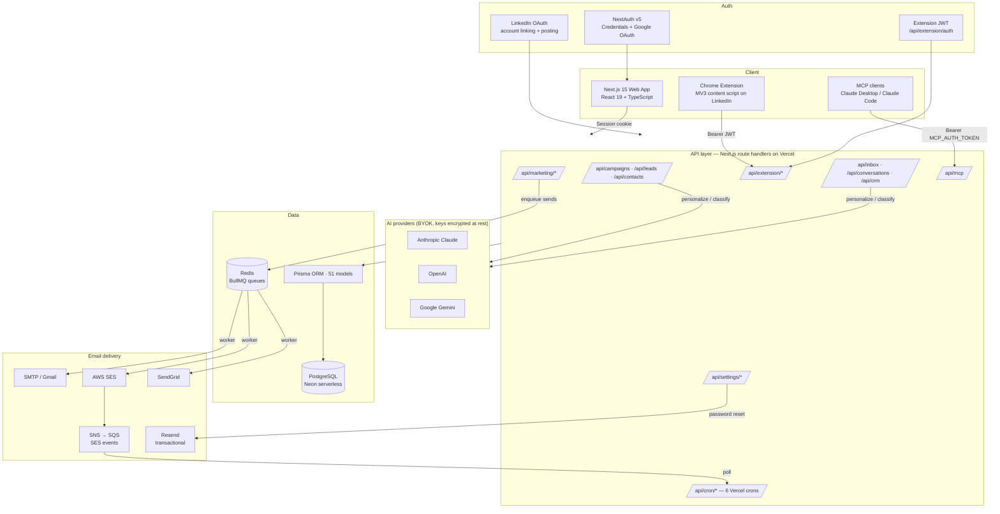

---

## User Flow

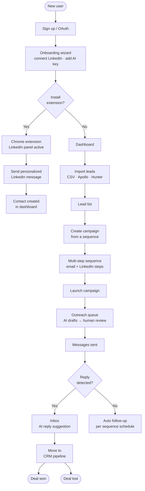

---

## Campaign Flow

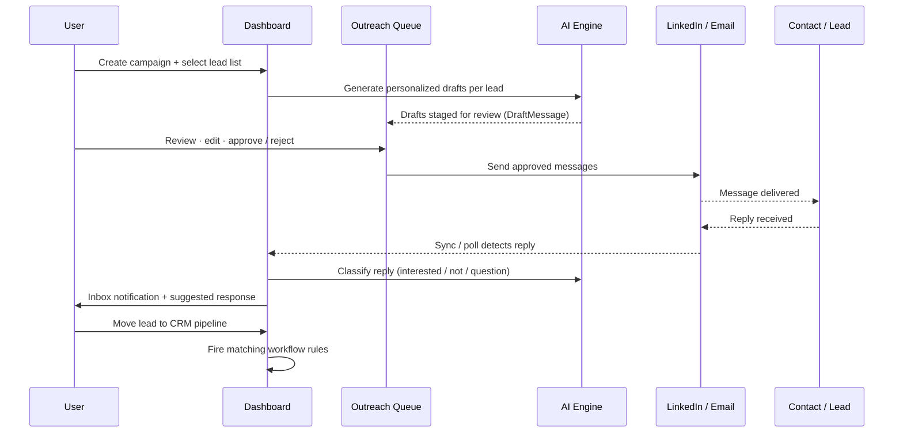

---

## Email Sending Pipeline

Broadcast (marketing) emails are sent asynchronously through a BullMQ queue so large lists never block a request.

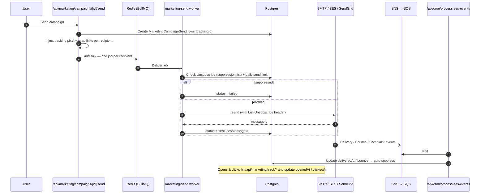

---

## Chrome Extension Auth

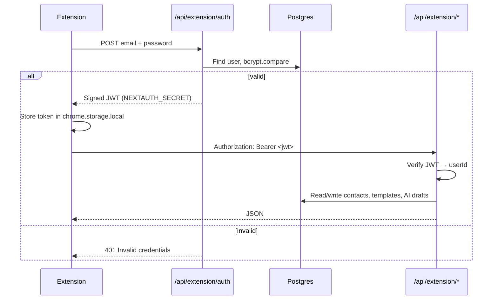

---

## Background Jobs

Scheduled via `webapp/vercel.json` crons (UTC). Each scheduled route checks `CRON_SECRET`.

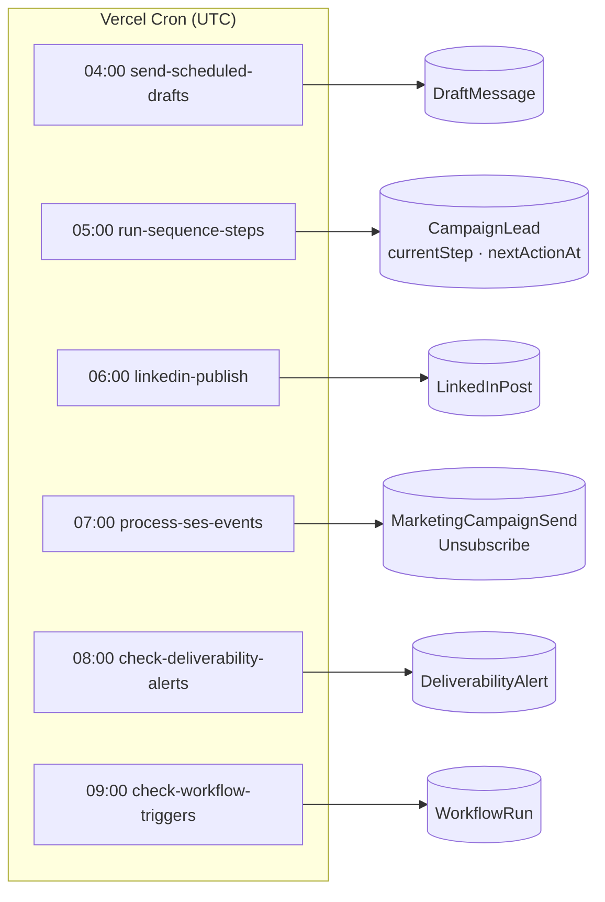

---

## Data Model

**51 Prisma models.** Almost every table is scoped by `userId` → `User`. Solid lines are foreign keys; dotted lines are soft references (ID columns without a DB constraint).

### Relationship overview

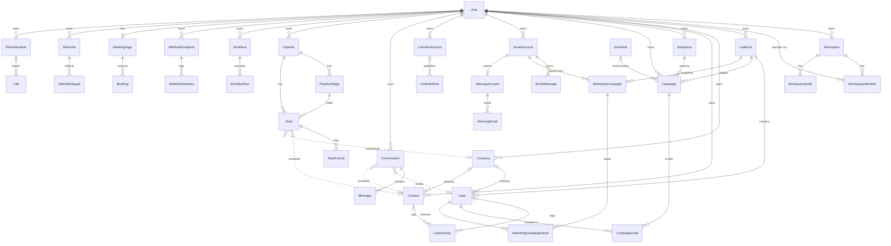

### Leads, companies & campaigns

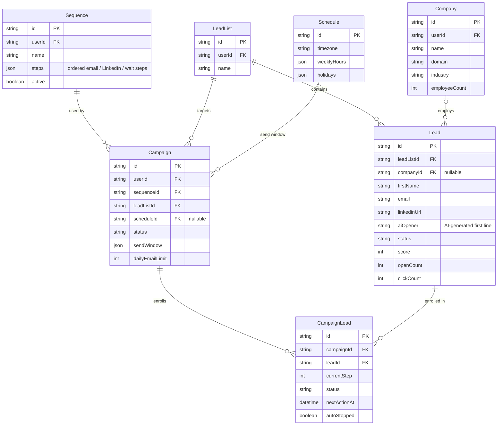

### Email, deliverability & marketing

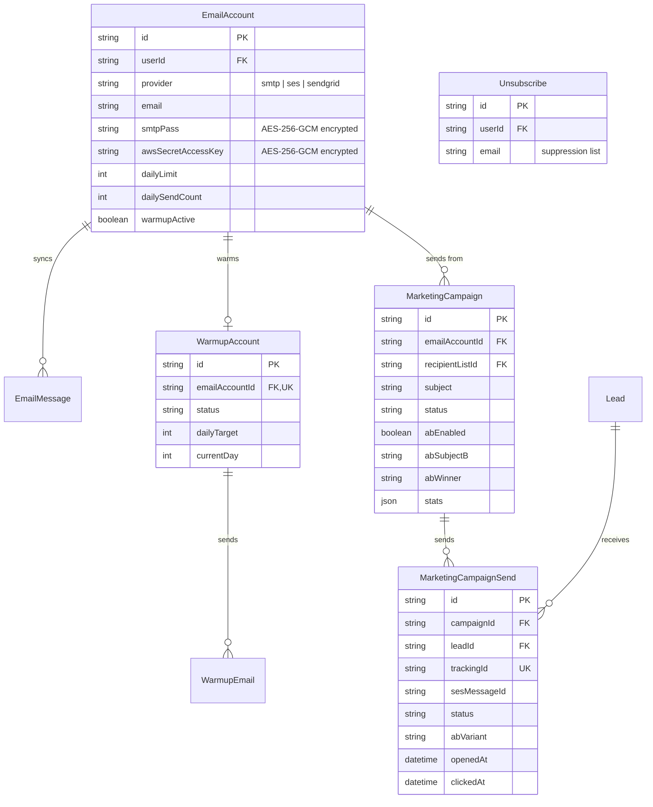

### Inbox & CRM

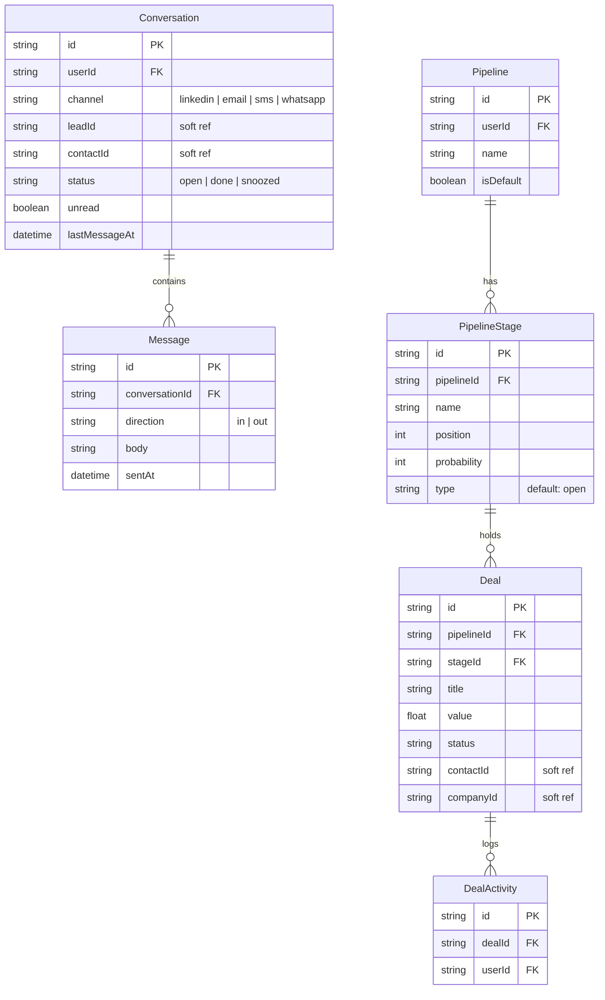

### All models by domain

| Domain | Models |
|--------|--------|
| Users & Workspaces | User, Workspace, WorkspaceMember, WorkspaceInvite |
| Leads & Companies | LeadList, Lead, Company, Contact, LeadActivity, CustomFieldDef, Task |
| Campaigns & Sequences | Campaign, CampaignLead, Sequence, Schedule, Template, DraftMessage, Snippet |
| Email & Deliverability | EmailAccount, EmailMessage, EmailEvent, WarmupAccount, WarmupEmail, Unsubscribe, DeliverabilityAlert |
| Marketing | MarketingCampaign, MarketingCampaignSend |
| LinkedIn | LinkedInAccount, LinkedInPost, LinkedInAction, CapturedPost |
| Inbox & Calls | Conversation, Message, ConversationLabel, PhoneNumber, Call |
| CRM | Pipeline, PipelineStage, Deal, DealActivity |
| Automation & Platform | Workflow, WorkflowRun, WebhookEndpoint, WebhookDelivery, Dashboard, Watchlist, WatchlistSignal, MeetingPage, Booking, WebsiteVisit, IssueReport |

Source of truth: [`webapp/prisma/schema.prisma`](webapp/prisma/schema.prisma).

---

### Deploy & migrations

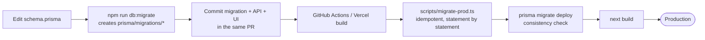

---

## Project Structure

```
outreachai/
├── webapp/                         ← Next.js 15 app (Vercel)
│   ├── app/
│   │   ├── layout.tsx              ← Root layout: fonts, analytics, dark mode
│   │   ├── page.tsx                ← Landing page
│   │   ├── api/                    ← ~175 API route handlers
│   │   │   ├── auth/               ← NextAuth + LinkedIn OAuth
│   │   │   ├── campaigns/          ← CRUD + launch + stats
│   │   │   ├── leads/              ← Lists + enrichment + hot-leads
│   │   │   ├── contacts/           ← LinkedIn contact tracking + import
│   │   │   ├── inbox/              ← Unified inbox sync
│   │   │   ├── conversations/      ← Channel-agnostic threads
│   │   │   ├── email/              ← Send + track opens/clicks/replies
│   │   │   ├── marketing/          ← Broadcast + A/B testing
│   │   │   ├── drafts/             ← Outreach queue (approve / reject)
│   │   │   ├── workflows/          ← Automation rules + runs
│   │   │   ├── pipelines/          ← CRM stages
│   │   │   ├── deals/              ← Deal CRUD + activities + stats
│   │   │   ├── meetings/           ← Booking pages + slots + bookings
│   │   │   ├── settings/           ← ai-keys · enrichment-keys · profile
│   │   │   ├── webhooks/           ← CRUD + HMAC delivery
│   │   │   ├── extension/          ← Auth + templates + personalize
│   │   │   ├── cron/               ← Scheduled jobs (sequences, warmup, etc.)
│   │   │   ├── ai/                 ← Classify reply · suggest reply · config
│   │   │   └── mcp/                ← MCP server token + tools
│   │   ├── dashboard/              ← Main dashboard
│   │   ├── campaigns/              ← Campaign list + detail
│   │   ├── leads/                  ← Lead lists + individual lead detail
│   │   ├── contacts/               ← Contact tracking table
│   │   ├── inbox/                  ← Unified inbox
│   │   ├── pipeline/               ← Kanban CRM board
│   │   ├── outreach-queue/         ← Review AI drafts before sending
│   │   ├── sequences/              ← Sequence builder + detail
│   │   ├── marketing/              ← Broadcast campaigns
│   │   ├── analytics/              ← Reports
│   │   ├── settings/               ← All user configuration
│   │   ├── workflows/              ← Automation builder
│   │   ├── meet/                   ← Public booking page
│   │   └── ...                     ← warmup · captured-posts · tasks · etc.
│   │
│   ├── components/
│   │   ├── Sidebar.tsx             ← Navigation + dark/light toggle + notifications
│   │   ├── AppShell.tsx            ← Layout wrapper (sidebar + content area)
│   │   ├── NavTour.tsx             ← First-time onboarding tour
│   │   └── ui/                     ← Shared design system
│   │       ├── Button.tsx          ← primary · secondary · ghost · danger
│   │       ├── Badge.tsx           ← 8 colour variants, /30 opacity dark mode
│   │       ├── Card.tsx            ← Card · CardHeader · CardBody
│   │       ├── Input.tsx           ← Input · Textarea · Select
│   │       └── PageHeader.tsx      ← title + subtitle pattern
│   │
│   ├── lib/
│   │   └── cn.ts                   ← tailwind-merge class utility
│   │
│   ├── prisma/
│   │   ├── schema.prisma           ← 47 models (1,162 lines)
│   │   └── migrations/             ← 33+ idempotent migrations
│   │
│   ├── scripts/
│   │   └── migrate-prod.ts         ← Runs on every Vercel build; safe, idempotent
│   │
│   └── tests/
│       ├── e2e/                    ← Playwright critical-path tests
│       └── smoke/                  ← Auth + API smoke tests
│
├── extension/                      ← Chrome MV3 extension
│   ├── manifest.json               ← Version bump here before publishing
│   ├── content.js                  ← LinkedIn page injection + panel
│   ├── popup.html / popup.js       ← Toolbar popup (sync + AI key)
│   └── background.js               ← Service worker (alarms, AI fallback)
│
├── docs/                           ← Additional documentation
├── CLAUDE.md                       ← AI coding guidelines for this repo
└── docs/                           ← Mintlify docs + guides/ (architecture write-ups)
```

---

## API Routes

### Cron Jobs (automated background tasks)

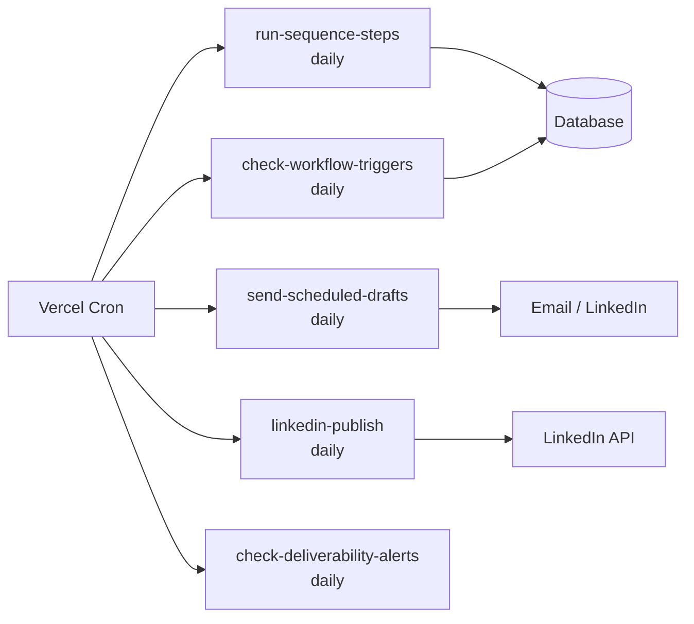

Vercel Hobby only permits daily cron schedules. For minute-level campaign or draft processing, use Vercel Pro or call the same `/api/cron/*` routes from an external scheduler with `Authorization: Bearer $CRON_SECRET`.

### Route Groups

| Group | Routes | Purpose |
|-------|--------|---------|
| Auth | `/api/auth/*`, `/api/extension/auth` | NextAuth, LinkedIn OAuth, extension JWT |
| Leads | `/api/leads/*`, `/api/lead-lists/*`, `/api/contacts/*`, `/api/companies/*` | Lead management, enrichment, import |
| Campaigns | `/api/campaigns/*`, `/api/sequences/*`, `/api/drafts/*` | Outreach campaigns and queue |
| Email | `/api/email/*`, `/api/email-accounts/*`, `/api/marketing/*` | Cold email + broadcast |
| LinkedIn | `/api/linkedin-accounts/*`, `/api/linkedin-posts/*`, `/api/linkedin-actions/*` | LinkedIn automation |
| Inbox | `/api/conversations/*`, `/api/inbox/*` | Unified messaging |
| CRM | `/api/pipelines/*`, `/api/deals/*` | Sales pipeline |
| AI | `/api/ai/*`, `/api/extension/personalize` | Reply classification, opening lines |
| Settings | `/api/settings/*` | AI keys, enrichment keys, profile |
| Platform | `/api/workflows/*`, `/api/webhooks/*`, `/api/meetings/*`, `/api/cron/*` | Automation and integrations |

---

## UI Component System

All pages share a single design token layer defined in `webapp/app/globals.css`:

```
Brand blue  →  --brand-blue: #0A66C2   →  bg-blue-600 / text-blue-600
Brand hover →  --brand-blue-hover: #0855a5  →  bg-blue-700
Focus ring  →  focus:ring-blue-600 (all inputs and buttons)
```

**Status badge pattern** (used on every page — do not deviate):
```
Light: bg-{color}-50  text-{color}-700  border border-{color}-200
Dark:  dark:bg-{color}-900/30  dark:text-{color}-400  dark:border-{color}-800/50
```

**Dark mode** is implemented via CSS variable inversion in `.dark {}` — bare utility classes (`bg-white`, `text-gray-900`) auto-flip without explicit `dark:` variants on marketing pages.

---

## Local Development Setup

### Prerequisites

- Node.js 20+
- A free [Neon](https://neon.tech) account (managed Postgres — no local DB setup needed)

### Step 1 — Clone and install

```bash
git clone https://github.com/outreachai-hq/outreachai
cd outreachai/webapp
npm install
```

### Step 2 — Create your `.env.local`

```bash
cp .env.example .env.local
```

Open `webapp/.env.local` and fill in the following:

| Variable | What to put | How |
|---|---|---|
| `DATABASE_URL` | Neon connection string | Sign up at [neon.tech](https://neon.tech) → New Project → copy the **connection string** |
| `NEXTAUTH_SECRET` | Random 32-char string | Run `openssl rand -hex 32` |
| `NEXTAUTH_URL` | `http://localhost:3000` | Hardcode this |
| `NEXT_PUBLIC_APP_URL` | `http://localhost:3000` | Hardcode this |
| `ENCRYPTION_KEY` | Random 32-char string | Run `openssl rand -hex 32` (use a different value than NEXTAUTH_SECRET) |

Everything else (`RESEND_API_KEY`, `GOOGLE_CLIENT_ID`, AI keys, etc.) is optional — the app runs without them; those features just won't work until you add keys.

### Step 3 — Run database migrations

```bash
# Still inside webapp/
npx prisma migrate deploy
```

### Step 4 — Start the dev server

```bash
npm run dev
```

Open [http://localhost:3000](http://localhost:3000). Sign up for a new account and you're in.

> **Tip:** AI features (personalization, reply suggestions) need an AI provider key. Go to **Settings → AI Providers** after logging in and paste in an Anthropic or OpenAI key. You don't need one set in `.env.local` — users can add their own in the UI.

---

## Quick Start (Docker)

```bash
git clone https://github.com/outreachai-hq/outreachai
cd outreachai
cp .env.docker.example .env
# Edit .env — set NEXTAUTH_SECRET, ENCRYPTION_KEY, NEXTAUTH_URL
docker compose up -d
open http://localhost:3000
```

> Generate secrets: `openssl rand -hex 32`

**Makefile shortcuts:**

```bash
make up          # Start all services
make down        # Stop all services
make logs        # Tail app logs
make db-migrate  # Run pending migrations
make db-reset    # Wipe volumes and restart fresh
```

---

## Environment Variables

| Variable | Required | Description |
|----------|----------|-------------|
| `NEXTAUTH_SECRET` | Yes | Random 32-char string — `openssl rand -hex 32` |
| `ENCRYPTION_KEY` | Yes | Random 32-char string for credential encryption |
| `NEXTAUTH_URL` | Yes | Public URL of your instance |
| `DATABASE_URL` | Yes | PostgreSQL connection string |
| `POSTGRES_PASSWORD` | Docker only | Password for bundled PostgreSQL container |
| `GOOGLE_CLIENT_ID` | No | Google OAuth (social login) |
| `GOOGLE_CLIENT_SECRET` | No | Google OAuth |
| `RESEND_API_KEY` | No | Transactional email (password reset etc.) |
| `ANTHROPIC_API_KEY` | No | Server-level AI key (users can override in Settings) |
| `OPENAI_API_KEY` | No | OpenAI key |
| `GEMINI_API_KEY` | No | Gemini key |

---

## Chrome Extension

The extension (`extension/`) injects into every `linkedin.com` page and provides:

- **Compose tab** — pick a template, auto-fill profile variables, AI-personalize the opener, fill the message box in one click
- **Templates tab** — edit templates locally; syncs your saved dashboard templates when connected
- **Tracker tab** — log sent messages, schedule follow-ups, mark replies
- **Posts tab** — capture visible LinkedIn posts and save them to the dashboard for repurposing

### Using the extension with a self-hosted instance

The published extension talks to `https://outreachai.in`. To use your own deployment, replace that origin across the extension and load it unpacked:

```bash
cd extension
# macOS sed shown; on Linux use: sed -i 's#...#...#g'
grep -rl 'https://outreachai.in' . | xargs sed -i '' 's#https://outreachai.in#https://your-domain.com#g'
```

Then open `chrome://extensions`, enable **Developer mode**, click **Load unpacked**, and select the `extension/` folder. The `host_permissions` entry in `manifest.json` is updated by the same command.

### Connecting the extension to the dashboard

1. Click the extension icon in your Chrome toolbar
2. Under **Dashboard Sync** — enter your OutreachAI email and password → **Connect to Dashboard**
3. Templates, contacts, and AI personalization sync automatically

> Using Google OAuth? Go to **Settings → Change password** to set a password first.

### Extension API routes (all require `Authorization: Bearer <jwt>`)

| Route | Method | Purpose |
|-------|--------|---------|
| `/api/extension/auth` | POST | Exchange email + password for a JWT |
| `/api/extension/templates` | GET / POST | Read / create user templates |
| `/api/extension/personalize` | POST | Generate AI opener using dashboard AI keys |
| `/api/captured-posts` | POST | Save scraped LinkedIn posts |
| `/api/contacts` | POST | Log sent message + schedule follow-up |
| `/api/leads/enrich-from-extension` | POST | Add lead to "Chrome Extension Leads" list |

### Publishing a new extension version

```bash
# 1. Bump version in extension/manifest.json
# 2. Package
zip -r outreachai-extension-vX.Y.zip extension/ \
  --exclude "*.DS_Store" --exclude "extension/screenshot*" \
  --exclude "extension/promo*" --exclude "extension/icon-gen.html" \
  --exclude "extension/INSTALL.md" --exclude "extension/RELEASE.md"
# 3. Publish
node cws-publish.mjs
```

---

## Running Tests

```bash
# Unit + smoke tests
npm test

# Full e2e critical path (Playwright)
npm run test:e2e

# Extension logic + live API tests (no browser needed)
cd webapp && npx playwright test tests/e2e/extension.spec.ts

# Smoke test against production after deploy
npm run test:critical:prod
```

---

## Deploy

### Vercel + Neon (recommended)

See [`docs/self-hosting.mdx`](docs/self-hosting.mdx) for the full guide.

### Further reading

- [Bulk email architecture (AWS SES)](docs/guides/bulk-email-architecture.md)
- [Design system](docs/guides/design-system.md)
- [How this project was built with Claude Code](docs/guides/build-with-ai.md)

```bash
cd webapp
vercel --prod
```

Migrations run automatically on every deploy via `scripts/migrate-prod.ts` — idempotent, statement-by-statement, skips already-applied objects.

### Adding a database migration

```bash
cd webapp
npm run db:migrate        # creates migration file + applies locally
# commit the new file in prisma/migrations/
# deploy → migrate-prod.ts applies it automatically
```

> Never use `prisma db push` in production — it bypasses migration history.

---

## License

Apache-2.0 — see [LICENSE](LICENSE).

## Contributing

Contributions are welcome! Please read [CONTRIBUTING.md](CONTRIBUTING.md) and the [Code of Conduct](CODE_OF_CONDUCT.md). To report a security vulnerability, follow [SECURITY.md](SECURITY.md) — please do not open a public issue.
